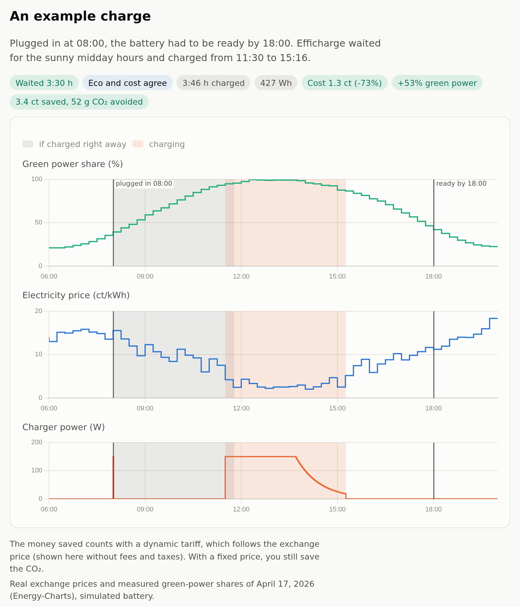

# Efficharge

**Charge any battery when electricity is cheap and green. Plug it in and forget it.**

**→ Use it at [efficharge.de](https://efficharge.de)**: nothing to install, a free web app.

E-bike, power station, power-tool batteries, lawn mower: Efficharge turns any
ordinary charger into a smart one, with nothing but a smart plug.

Electricity prices and the share of renewable power change every 15 minutes. On a sunny
noon or a windy night power is cheap and mostly green; in the evening peak it is expensive
and comes from gas and coal. A battery rarely needs to charge the moment you plug it in.
It only has to be full when you leave.

Efficharge watches a smart plug. When it sees a charger start drawing power, it switches
the plug off and turns it back on in the cheapest / greenest window before your deadline.
Press the plug's button if you need it charged right now.

<picture>
  <source media="(prefers-color-scheme: dark)" srcset="docs/example-charge-dark.png">
  
</picture>

## How it works

1. **Connect your plug:** log in with your Meross app account once and pick the plug your
   charger is on. The password is used once to get a token and is never stored.
2. **Plug in as usual:** Efficharge sees the power draw and switches the plug off for now.
3. **It finds the best window** from the day-ahead exchange price and the green-power
   forecast ([Energy-Charts](https://www.energy-charts.info)), before your deadline.
4. **The battery is ready:** the plug turns on, the charger finishes, and you see what it
   saved in € and CO₂ compared with charging right away.

## Features

- **Deadlines are rules:** "Mon–Fri, plugged in 08:00–15:00 → ready by 18:00",
  otherwise "ready within 12 h".
- **The charge time is learned:** your own estimate first, then the real charges
  (90th percentile, so the battery is ready in ~9 of 10 cases).
- **Eco or money first:** the window is chosen by the green-power forecast, the exchange
  price, or a mix. Every charge shows what it saved.
- **The plug's button wins:** press it while waiting to charge now, or while charging to pause.
- **Fail-safe:** on errors or lost connections the plug is switched on. Better charged
  inefficiently than not at all.
- **Phone first:** installable web app, German and English, light and dark.
- **A live demo** with a simulated plug and its own fast-forward clock, no account needed.

## What you need

- A **Meross** smart plug with power metering (MSS305, MSS310, MSS315). More brands are on
  the roadmap (Shelly / Tasmota via MQTT, Home Assistant, a local bridge for Tapo).
- A charger that starts again by itself when power comes back (most do: e-bikes, power
  stations, power tools, lawn mowers).
- Electricity in the **DE-LU** price zone (Germany, Luxembourg). With a dynamic tariff you
  save money and CO₂; with a fixed price you still save CO₂.

## Privacy

No ads, no tracking, no third-party scripts or fonts, one session cookie, no access log; visits are only counted anonymously (numbers per day, nothing about the visitor). Users delete their account and all its data themselves.
Meross tokens are stored encrypted (AES-GCM), passwords only as argon2id hashes. The full
notice, including what the Meross cloud sees, is served at `/privacy`
([German](efficharge/web/templates/privacy_de.html),
[English](efficharge/web/templates/privacy_en.html)).

## Status

Beta at [efficharge.de](https://efficharge.de); registrations are approved by hand.
Plugs: Meross (cloud).

Planned next: more plugs (Shelly and Tasmota over MQTT, Home Assistant, a small local bridge
for plugs without a cloud API such as Tapo), a public API so a home system can ask "should
I charge now?", and push notifications.

## Run it locally

Needs Python 3.12 and [uv](https://docs.astral.sh/uv/).

```bash
uv sync
uv run efficharge serve --dev     # http://127.0.0.1:8000
```

`--dev` keeps its keys in `.efficharge-dev.env` (git-ignored), its data in `dev.db`, and
allows registration. Register, and *Settings* welcomes you: *Connect Meross*, log in with your
Meross app account, pick the plug your charger is on and say how long a full charge takes.
No plug? *Try a virtual plug first* (a simulated plug and battery), and `/demo` shows one
without an account.

`uv run efficharge demo` runs a simulated plug against real prices, sped up, in the terminal.

The start page's example charge is real data of one past day, run through the app's planner
with the demo battery: `uv run efficharge make-example 2026-04-17 --plugged 08:00` rebuilds it (any past day,
`--plugged` and `--ready` times).

## How it is built

Python 3.12, FastAPI, SQLAlchemy + SQLite, server-rendered Jinja + HTMX, Chart.js, no JS
build step. One process: the web app, one state machine per plug, the energy-data fetcher
and a maintenance job. The planner and the state machine are pure functions (no I/O, no
clock), so they are tested without a plug. More in [`ARCHITECTURE.md`](ARCHITECTURE.md).

## Development

```bash
uv sync
uv run pytest
uv run ruff check . && uv run ruff format --check .
```

New UI strings need a German translation; `tests/test_i18n.py` fails otherwise.

## Support

Efficharge is a free hobby project. If you like it, you can support me:
[☕ Buy me a coffee](https://buymeacoffee.com/andigerken). Bug reports and ideas are welcome
as GitHub issues.

## Credits

Built by Andreas Gerken, with [Claude Code](https://claude.com/claude-code) (Claude Opus 5.5)
as a coding assistant.

## Disclaimer

Use at your own risk. Efficharge is a beta, provided without any warranty (see the
license). It switches plugs through Meross's cloud with the unofficial open-source library
[`meross_iot`](https://github.com/albertogeniola/MerossIot), which neither this project nor
Meross controls. It is tested, but it can fail, for example when Meross changes its cloud.
The battery is not at risk: efficharge only switches the charger's power, and the charger
still controls the charging. At worst, a battery is not charged in time.

## License

Copyright © 2026 Andreas Gerken. AGPL-3.0-or-later, see [`LICENSE`](LICENSE). If you run a
modified version for others, you must offer them its source.

Energy data: [Energy-Charts](https://www.energy-charts.info) (Fraunhofer ISE), prices from
Bundesnetzagentur | SMARD.de, licensed CC BY 4.0. Efficharge is not affiliated with Meross.
